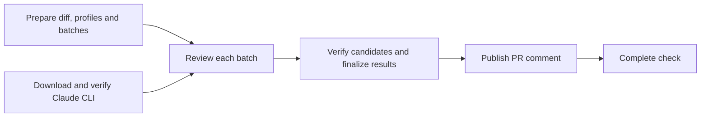

# AI Security Review

For repository owners evaluating or setting up automated security review; setup requires permission to configure GitHub
Actions and Anthropic access.

AI Security Review checks pull requests and merge-queue changes using dependency-source policy checks, AI review, and a
separate pass over candidate findings. Verified HIGH and MEDIUM findings are advisory by default; incomplete reviews and
source-policy violations fail the workflow. It supports human review and does not certify that a change is safe.

| You want to                | Read                                                                     |
| -------------------------- | ------------------------------------------------------------------------ |
| Decide whether to adopt    | This page and [security limitations](docs/security-model.md#limitations) |
| Add it to a repository     | [Set up](#set-up)                                                        |
| Configure Anthropic access | [Authentication](docs/authentication.md)                                 |
| Make it block merges       | [Required review](docs/required-review.md)                               |
| Understand a PR comment    | [Results and next steps](docs/results.md)                                |
| Tune what gets reviewed    | [Configuration](docs/configuration.md)                                   |
| Audit the engine           | [Security model](docs/security-model.md)                                 |
| Change the engine          | [Maintainer guide](MAINTAINING.md) and [changelog](CHANGELOG.md)         |

## How It Works

Consumers call [matter-labs/zksync-ci-common](https://github.com/matter-labs/zksync-ci-common)'s reusable workflow at a
reviewed full commit SHA. Jobs run in the consumer repository's Actions context. The public engine checkout needs no
additional personal access token.



This diagram shows the normal PR flow. The verifier model runs only when candidates need checking; merge-group reviews
upload results without a PR comment. The final completion check also runs after failures or skipped jobs.

| Term         | Meaning                                                        |
| ------------ | -------------------------------------------------------------- |
| Unit         | One reviewable patch section or dependency-context record.     |
| Batch        | Related units assigned to one reviewer session.                |
| Candidate    | A suspected vulnerability reported by a reviewer.              |
| Finding      | A candidate retained after verification and reporting filters. |
| Verification | A separate model pass that challenges reported candidates.     |
| Profile      | Built-in guidance for a language or security domain.           |
| Context      | Repository-specific guidance loaded from the PR base commit.   |
| Notice       | A deterministic signal that needs human investigation.         |

Each reviewer batch starts a paid model session; candidate verification can add another. Merge queues review the queued
changes again. See [budgets and concurrency](docs/configuration.md#budgets-and-concurrency) before enabling automatic
reviews across many repositories.

## Set Up

Complete these five steps from the consumer repository. Use Bash, an authenticated GitHub CLI, Node.js 22 or later, and
a reviewed local engine checkout. GitHub Actions policies must permit the engine and its referenced actions.

### Configure the Repository

First, add `.github/ai-security-review.json`:

```json
{
  "version": 1,
  "profiles": ["domains/authorization", "domains/privacy-data-exposure"],
  "context": [".github/security-review-focus.md"]
}
```

Create the focus file with your application's assets and security invariants. Start from the
[application](examples/focus/app.md) or [CI](examples/focus/ci.md) sample and adapt it to your repository.
[Multiple focus files](docs/configuration.md#use-multiple-focus-files) can describe different areas.

Merge the configuration and focus files into the base branch before enabling review. Changes on a PR cannot alter the
trusted guidance used for that PR.

### Verify an Engine Revision

For both authentication methods, verify the reviewed engine commit before configuring credentials or federation trust.
From the consumer repository root, use Bash and an authenticated GitHub CLI:

```bash
set -euo pipefail
read -r -p "Reviewed full engine commit SHA: " AI_SECURITY_REVIEW_SHA
if [[ ! "$AI_SECURITY_REVIEW_SHA" =~ ^[0-9a-f]{40}$ ]]; then
  echo "Enter the full 40-character reviewed commit SHA." >&2
  exit 1
fi
AI_SECURITY_REVIEW_ANCESTRY=$(
  gh api "repos/matter-labs/zksync-ci-common/compare/$AI_SECURITY_REVIEW_SHA...main" --jq '.status'
)
case "$AI_SECURITY_REVIEW_ANCESTRY" in
  ahead|identical) ;;
  *)
    echo "The engine SHA must be reachable from matter-labs/zksync-ci-common main." >&2
    exit 1
    ;;
esac
gh api --silent "repos/matter-labs/zksync-ci-common/contents/.github/workflows/ai-security-review.yaml?ref=$AI_SECURITY_REVIEW_SHA"
gh api --silent "repos/matter-labs/zksync-ci-common/contents/ai-security-review/actions/prepare/action.yml?ref=$AI_SECURITY_REVIEW_SHA"
```

GitHub shares commits between a repository and its forks. A commit that exists only in someone's fork can still be
fetched as `matter-labs/zksync-ci-common@<sha>`. Finding the expected files at that SHA therefore does not prove that
the commit belongs to `main`.

The script compares the selected SHA with `main`, using the SHA as the comparison's base. `identical` means the SHA is
the current tip of `main`; `ahead` means `main` has advanced beyond that commit and still contains it in its history.
The script stops for any other result or an API error. See the
[comparison API](https://docs.github.com/en/rest/commits/commits#compare-two-commits).

Passing confirms that the commit is part of `main`'s history. You still need to review the code in the revision you pin.
Use the same verified SHA in the federation rule: it trusts whatever SHA an administrator authorizes, including a
fork-only commit.

### Configure Authentication

Next, follow [authentication setup](docs/authentication.md) to authorize the verified engine SHA and intended consumer.
Choose workload identity federation or the explicit API-key secret mapping; the caller examples use federation.

### Create a Repository Caller

Generate the caller from the consumer repository root, in the same shell where you verified `AI_SECURITY_REVIEW_SHA`:

```bash
read -r -p "Absolute path to your reviewed zksync-ci-common checkout: " AI_SECURITY_REVIEW_CHECKOUT
node "$AI_SECURITY_REVIEW_CHECKOUT/ai-security-review/examples/create-caller.mjs" "$AI_SECURITY_REVIEW_SHA"
```

The generator creates `.github/workflows/ai-security-review-caller.yaml` with a literal full-SHA pin and refuses to
overwrite an existing file. It runs offline, so it cannot replace the ancestry check above. Review the generated file
before committing it.

The default template reviews non-draft, same-repository PRs. Use the
[template index](examples/README.md#caller-templates) to select labelled drafts, merge queues, or required reviews.
Install only one caller.

### Make the Review Required

Optionally follow [required-review setup](docs/required-review.md). The `fail_on_findings` input and GitHub's
required-check setting are separate controls; configuring only one does not fully configure a merge gate.

## Limits in Brief

- Verification challenges candidates; it does not independently re-review units declared clean.
- Read coverage proves delivery of source text, not understanding or complete vulnerability detection.
- Prompt-injection notices and output redaction reduce specific risks without providing complete protection.
- Dependency checks cover documented sources and formats; submodule code and known binary assets are not reviewed.
- Repository-owned callers can change in PRs. Code-owner approval controls merging, not execution before approval.

Read the [security model and limitations](docs/security-model.md#limitations) for the precise boundaries, including
source visibility and credential handling. For a run already in progress, use [results and next steps](docs/results.md).

## License

The engine follows the repository's [MIT](../LICENSE-MIT) or [Apache-2.0](../LICENSE-APACHE) licenses. Claude Code is
downloaded at runtime under its own terms; its binary is not included in this source tree.
